<picture>
  <source media="(prefers-color-scheme: dark)" srcset="assets/hero-dark.svg">
  
</picture>

<p>
  
  
  
  <a href="https://github.com/Alcagoita/brush-frame"></a>
</p>

What your AI work costs, beside the chat: each prompt, each task, each session — and for whoever runs the sprint, the sprint by task and who is working now. A Claude Code mod.

When a conversation gets long or each prompt starts costing much more than at the start, Pigment suggests a fresh start: **Optimize now** writes a short summary of the work in progress and copies it, ready to paste: open a new session, paste, and it carries on from there. It never replaces compacting; it's a calmer, separate option.

Costs are local estimates at list price, as `/cost` shows them. On a subscription they are what the work would cost, not what you pay.

## Install

In Claude Code:

```
/plugin install pigment --marketplace Alcagoita/pigment
```

Answer `y` to add the marketplace, then pick a scope. The pane opens on the side; `/pigment` reopens it.

## Two views

<picture>
  <source media="(prefers-color-scheme: dark)" srcset="assets/views-dark.svg">
  
</picture>

Pick one in `/config`, under Pigment (**View**).

**Your work** (developer)
- **This prompt** — what the last prompt cost, tokens written and read from memory
- **This task · KAN-55** — every session on that ticket together
- **This session** — the running total, and how long the conversation has grown
- **Earlier prompts** — newest first
- **Log your time** — when your task reaches **Testing** in Jira (or Done), Pigment offers: *"KAN-55 is in Testing. Log the 5h 10m you worked on it in Jira?"* Press **Log it in Jira** and it adds a worklog; press **Not now** and nothing is sent. Only your own worked time, never logged twice. Uses your Jira connection (below); the status is a setting (**Log time at status**).

**The sprint** (manager)
- **The team now** — under the manager's figure, a small developer figure for each person working right now, with their name and task. Someone who stops for ten minutes or closes the session leaves the row.
- **Sprint 22 so far** — the total, from Jira's open sprint
- **Worth a look** — a task close to its estimate or past it (*"KAN-045 has used 5h of its 6h."*), and sessions that have gone quiet (*"Ana's session on KAN-045 has been quiet for 1h 20m."*). A quiet session can mean someone is stuck, waiting on an answer, or simply away; it's a reason to ask, not to judge.
- **In development** — every task in an in-progress status, with its time so far (`KAN-045 · 5h of 6h`, `KAN-96 · 2h`); the ones worth a look come first
- **By task** — each ticket in the sprint with its cost and time; spending on branches without a ticket shows as "No ticket"
- **Working now** — each session active in the last ten minutes, with its person, task and running cost
- **Sprint summary** — when Jira's open sprint ends, Pigment writes `.pigment/sprints/sprint-22.md` with the total cost, prompts and worked time, and a row per task (cost, prompts, worked, estimate, state). **Write a summary now** does the same for the sprint so far. The card offers **Copy the summary** for a retro or a release note.

**Time is worked time**, not the clock on the wall: each prompt's turn, plus the reading and thinking before it when the gap is under 15 minutes. Longer pauses, nights and weekends don't count. Every person's sessions on a ticket add up.

**Jira, with nothing to set up.** If Claude Code already has the Atlassian connector signed in (the one `/mcp` lists, however it's named), Pigment uses it: it finds your site, takes the project from the branch's ticket (`KAN-55-…` → `KAN`), reads the open sprint and logs time through it. No token, no settings. The connector's own sign-in is what's used; a worklog is only ever added when you press **Log it in Jira**. A task in development started when it entered that status in Jira. The Jira settings in `/config` are only for someone without the connector.

With Jira, done is when the ticket was resolved and the time it was given is its original estimate; a task is worth a look at 80% of it. Without Jira, the list shows tasks worked on in the last three days.

A session is **quiet** when it's still open but nothing has happened for 45 minutes. Sessions that close say so, so they're never mistaken for quiet ones; after 12 hours of silence a session is left alone.

The ticket comes from the branch name: `KAN-55-invite-link` → KAN-55, `12-invite` → #12. A team that names branches after tickets needs nothing else.

## Where the numbers live

The first time Pigment runs in a project, it asks: **"Where should I keep the numbers?"**

- **In your cloud** — safe if a computer goes, and a team sees the sprint together. Needed for a team.
- **Just on this computer** — a file per person and month in the project's `.pigment/` folder (`.pigment/ana-2026-11.jsonl`), kept out of git. Nothing leaves your machine. It isn't backed up.

Until you choose, Pigment keeps counting and holds the numbers until they have a place, so nothing is lost. The choice is written to `.pigment/config.json` in the project — never a key, only where the numbers go — so everyone who opens the project finds the same answer.

Only numbers are ever stored: the ticket, the session, a display name, cost and token counts. Never prompts, answers or code.

## Solo setup

Install, open your project, and answer the question. That's all. Choose the cloud later whenever you like; whatever was counted locally is sent once the server is set.

## Manager setup (a team, once)

Whoever sets up the project does this once.

1. Install Pigment and set **View** to `manager` in `/config`.
2. Set up the team server on Cloudflare (the free plan is enough). From a clone of this repository:
   ```bash
   server/setup.sh --project /path/to/your/project
   ```
   You log in to Cloudflare in the browser; the script creates the database, the team key and the server, and writes `.pigment/config.json` and the project's `.claude/settings.json` (Pigment's marketplace, enabled for the project). The key is saved to a private file on your computer (`~/.pigment/keys/…`) and never printed.
3. Commit `.pigment/` and `.claude/settings.json`. From then on, **everyone who opens the project in Claude Code is offered Pigment** — no install line to share.
4. Nothing to do for the key on this computer: Pigment finds the one the setup saved and connects by itself. For the sprint list, nothing either if Claude Code has the Atlassian connector signed in; otherwise add the Jira site, project key, email and API token in `/config` under Pigment.
5. Share the team key with each developer privately: a password manager or a direct message, never the repository or a public channel.

## Developer setup (joining a team)

The project already has Pigment configured (`.pigment/config.json` is in the repository).

1. Open the project in Claude Code and trust the folder. Claude Code offers to install Pigment, because the project asks for it — say yes. (Or install it with the line above.)
2. Pigment starts by itself, finds the team's server and shows **Developer setup**.
3. Paste the team key whoever set up the project gave you into the box in the pane and press **Connect**. Pigment checks it with the server and keeps it on your computer only (`~/.pigment/keys/`, readable only by you). Set **Your name** in `/config` under Pigment so you appear by name in the sprint.

That's all. Until the key is in, Pigment counts on your computer and sends it all once it can.

## Settings

| Setting | Who | What it does |
|---|---|---|
| View | everyone | `developer` or `manager` |
| Your name | team | How you appear in the sprint view |
| Team key | team | The key the team server was set up with (kept in secure storage) |
| Project folder | optional | Count only sessions inside this folder |
| Team server | optional | Only for projects without `.pigment/config.json` |
| Jira site, project key, email, API token | manager | Only without the Atlassian connector: the open sprint's ticket list. With neither, the sprint view shows the last two weeks by task |

## Read it kindly

Pigment leads with tasks and the sprint, not with people. It's there to see how the team uses AI and where a task got expensive, not to rank anyone.

## Develop

- `node server/test.mjs` — the server, against an in-memory database
- `claude plugin test plugin` — the mod: both views, the storage choice, developer setup, sending to the server
- `claude plugin validate plugin`
- `server/setup.sh --project <folder> --dry-run` — what the server setup would do

## Author

**Olegário Nascimento**, Tech Lead and Engineering Manager, building software since 2012. Pigment is the optional companion to [Brush Frame](https://github.com/Alcagoita/brush-frame), a human-led way to build software with AI by the same author, and is used to track the AI work behind [Brush](https://brushaway.app).

## Licence

CC0 1.0 — public domain. Use and change it freely.
